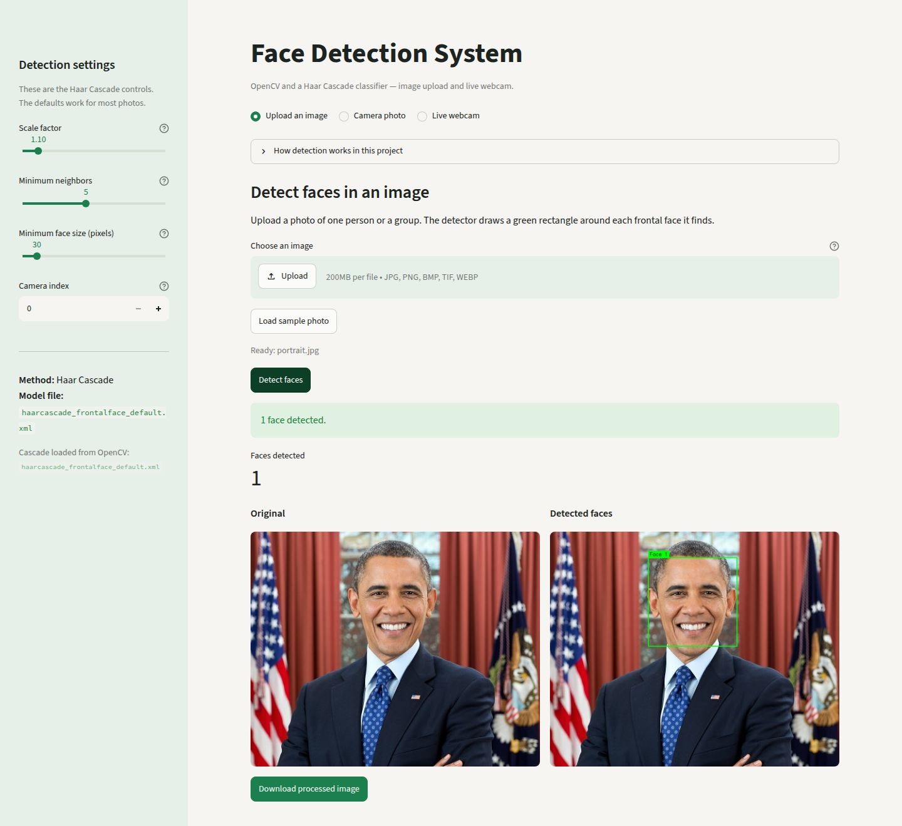

# Face Detection System using OpenCV and Haar Cascade Classifiers

A small Python application that finds human faces in photos and in live webcam video. Detection uses OpenCV's built-in Haar Cascade classifier (`haarcascade_frontalface_default.xml`). Each face is marked with a green rectangle, and the app reports how many faces it found.

This project is meant as a college engineering demonstration: the code is split into a detector module and a Streamlit interface, it handles missing files and a missing camera, and it does not use a deep-learning face detector.

## Objectives

- Detect one or many frontal faces in images of different sizes.
- Draw a green rectangle around every detected face and show the total count.
- Say clearly when no face is detected.
- Let the user upload an image, inspect the result, and download the processed image.
- Run the same detector on live webcam frames, and release the camera on exit.
- Fail with a readable message when an image path is wrong or a webcam is unavailable.

## Features

- Image upload (JPG, PNG, BMP, TIFF, WEBP) with a **Detect faces** button.
- Optional sample photo, when one is placed in `samples/`.
- Browser camera snapshot (**Camera photo** mode).
- Live webcam preview inside the app, with **Stop and release camera**.
- Desktop window mode (`python webcam_live.py`) that quits on **Q**, **Esc**, or closing the window.
- Adjustable scale factor, minimum neighbors, and minimum face size.
- Download of the annotated image as PNG.
- Unit tests for the detector, including missing files and an unavailable camera index.

## Technologies

| Piece | Role |
| --- | --- |
| Python 3.10+ | Language |
| OpenCV (`opencv-python-headless`) | Images, video capture, and the Haar cascade file |
| NumPy | Image arrays |
| Streamlit | Local web interface |
| pytest | Tests |

The cascade XML is loaded from `cv2.data.haarcascades`. Nothing is downloaded at runtime.

## How Haar Cascade face detection works

Paul Viola and Michael Jones (2001) detected objects by scanning an image with a sliding window at several sizes. Each window is described by **Haar-like features**: simple patterns of bright and dark rectangles (edges, lines, and center-surround shapes). Those features are cheap to compute with an integral image.

During training, AdaBoost picks the features that best separate faces from non-faces and arranges them in a **cascade**. The first stages reject obvious background (a wall, a tree, a blank page) very quickly. Later stages only run on windows that still look promising. OpenCV ships a cascade that was already trained for **frontal** faces. This project loads that file and calls `detectMultiScale`.

Three settings matter in the app:

- **Scale factor** — how much the image shrinks before the next scan. `1.1` means each step is 10% smaller. Values closer to 1 look at more sizes and are slower.
- **Minimum neighbors** — how many overlapping detections must agree before a box is kept. Raising it reduces false faces and can hide a faint one.
- **Minimum face size** — detections smaller than this are discarded.

Before detection, the photo is converted to grayscale and its contrast is equalized, which helps when one side of the face is darker. Very wide images are scaled down for the scan, and the boxes are mapped back to the original pixels. The result is a location, not an identity: the system does not recognize who the person is.

## Installation

From the project folder:

```bash
python3 -m venv .venv
```

Activate the virtual environment:

```bash
# macOS and Linux
source .venv/bin/activate

# Windows (Command Prompt)
.venv\Scripts\activate

# Windows (PowerShell)
.venv\Scripts\Activate.ps1
```

Install the dependencies:

```bash
pip install -r requirements.txt
```

Python 3.10 or newer is required. The same paths work on macOS and Windows because the code uses `pathlib` and `cv2.data.haarcascades` instead of hard-coded separators.

## How to run the application

Start the interface (this is the app you should use for the demo):

```bash
streamlit run app.py
```

Streamlit prints a local URL, usually `http://localhost:8741` in this project because `.streamlit/config.toml` sets that port. If you omit the config, Streamlit uses port 8501.

Then:

1. Open **Upload an image**, choose a photo, and click **Detect faces**.
2. Read the face count. If nobody was found, the page says **No face detected**.
3. Click **Download processed image** to save the photo with green boxes.
4. Open **Camera photo**, allow the browser camera, take a picture, and click **Detect faces in this photo**.
5. Open **Live webcam** and click **Start live detection**. Click **Stop and release camera** when you are done.

A separate desktop window, useful when you want the classic OpenCV preview:

```bash
python webcam_live.py
```

Press **Q** or **Esc**, or close the window. **Ctrl+C** also releases the camera.

The desktop window calls `cv2.imshow`. The `opencv-python-headless` package used here can capture and process frames, but it cannot open that window. On a laptop, replace it with the full package if you need the window:

```bash
pip uninstall opencv-python-headless -y
pip install opencv-python
```

Photo upload, download, and the in-app live preview keep working with the headless package. Live preview uses the camera of the computer running Streamlit, not a remote server.

Annotate a single file from the terminal:

```bash
python face_detector.py path/to/photo.jpg -o detected-faces.png
```

Run the tests:

```bash
pytest
```

## Project structure

```text
.
├── app.py                 # Streamlit interface
├── face_detector.py       # Cascade loading, detection, drawing, webcam helpers
├── webcam_live.py         # Desktop live view (Q / Esc to quit)
├── requirements.txt
├── pytest.ini
├── tests/
│   └── test_face_detector.py
├── samples/
│   └── portrait.jpg       # Public-domain demo photo (one frontal face)
├── .streamlit/config.toml # Port and theme
├── .gitignore
└── README.md
```

## Example usage

**One face in a photo.** Click **Load sample photo**, then **Detect faces**. The included sample is a cropped official portrait of Barack Obama (Pete Souza, White House, 6 December 2012; US government work, public domain). With the default settings the result is `1 face detected.` and a green box labeled `Face 1`. Download `faces-detected-1.png`. The lower part of the original frame was cropped because it produced an extra false detection on the desk.

**Several faces.** Use a group photo where people are looking toward the camera. The count matches the number of boxes. Small faces in the background may be missed until you lower **Minimum face size**.

**No face.** Upload a picture of an object or a pet. The app keeps the photo, draws no boxes, and shows: `No face detected. Try a clearer, front-facing photo with better lighting, or lower the minimum face size.`

**Bad path (terminal).**

```bash
python face_detector.py missing.jpg
```

The program prints `Error: Image file not found: missing.jpg` and exits with status 1. It does not crash with a traceback.

**Webcam already in use, or no camera.** Live mode shows `Could not open webcam (camera index 0)...` and leaves the camera released. Change **Camera index** in the sidebar if the built-in camera is not index 0. On Windows the detector retries once with DirectShow.

## Screenshot

Screenshot of the running application (sample portrait, one face found):



## Limitations

- The cascade is trained for **frontal** faces. Profile views, strong occlusion, blur, and very small faces are often missed.
- Patterns that look a bit like a face (masks, drawings, posters) can produce a false box. Raise **Minimum neighbors** when that happens.
- Uneven lighting still causes misses, even with histogram equalization.
- This is detection only. It does not recognize a person, estimate age, or track identity across frames.
- Live webcam mode in Streamlit needs a camera on the machine that runs `streamlit run app.py`. A cloud server with no camera will show the "could not open webcam" message. That is expected.
- `python webcam_live.py` needs a display and the full `opencv-python` build.
- The browser **Camera photo** button depends on the browser allowing camera access.

## Possible improvements

- Add the profile-face cascade for side views, still without switching to a neural network.
- Detect eyes inside each face box as a second cascade stage.
- Save a short annotated video from the webcam.
- Add a face-recognition stage as a separate project if identification becomes a requirement.

## For a project viva

You can explain the work in four steps:

1. **Input.** A photo is decoded with OpenCV, or a frame is read from the webcam. Color images are stored as BGR.
2. **Preprocessing.** The frame becomes grayscale, contrast is equalized, and very large images are reduced before the scan.
3. **Detection.** `CascadeClassifier.detectMultiScale` runs the Viola-Jones cascade from OpenCV's `haarcascade_frontalface_default.xml`. Each kept window is an `(x, y, width, height)` box.
4. **Output.** The app draws green rectangles, counts the boxes, and either shows "No face detected" or lets the user download the annotated PNG. Stopping live mode calls `VideoCapture.release()`.

If an examiner asks why this is not a neural network: Haar features and a boosted cascade are a classical machine-learning detector. The XML file is the trained cascade that OpenCV already includes. No DNN model is loaded.
